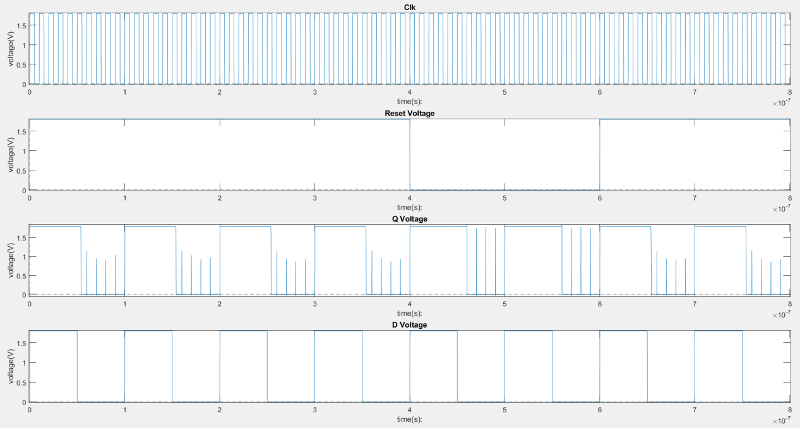
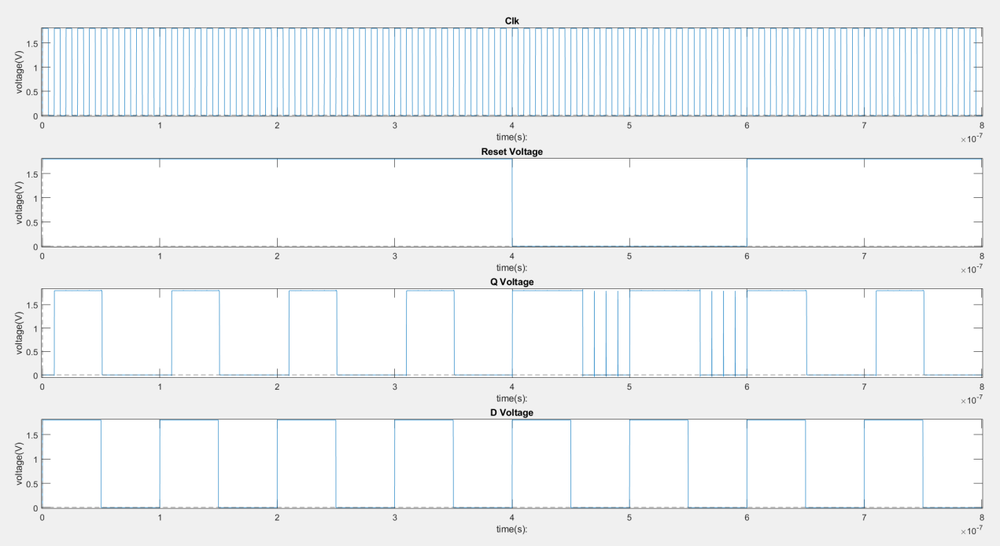
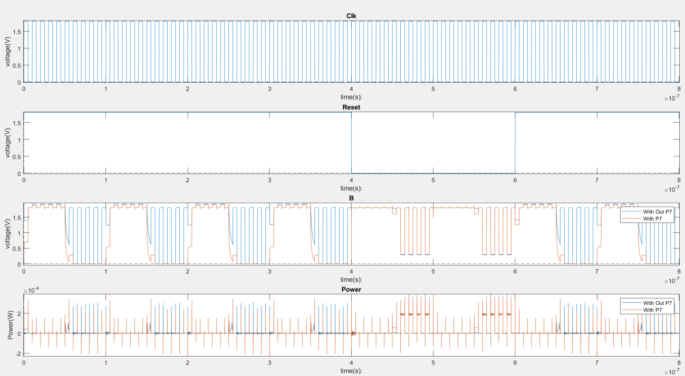
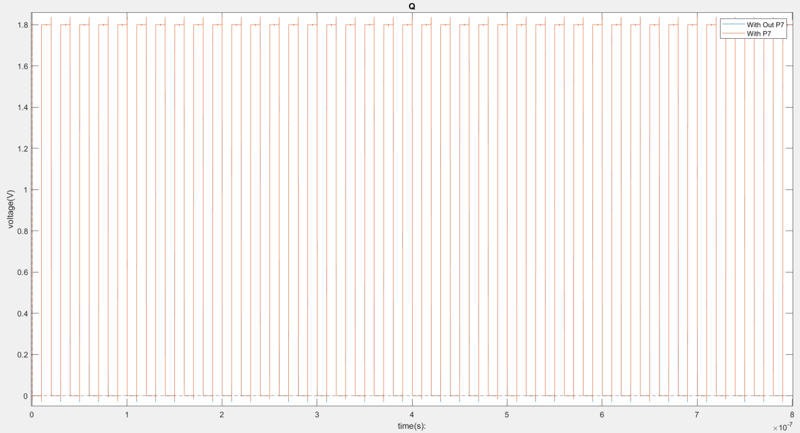
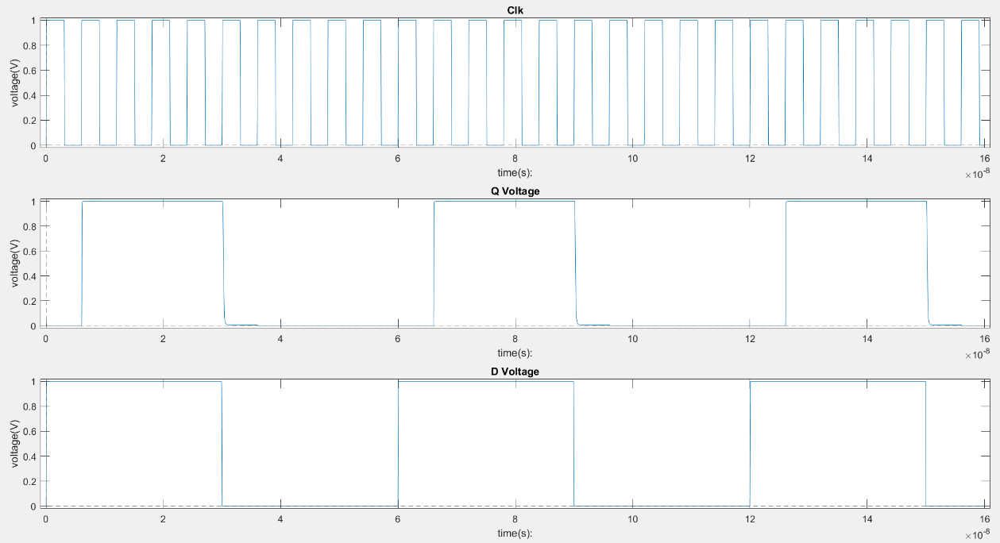
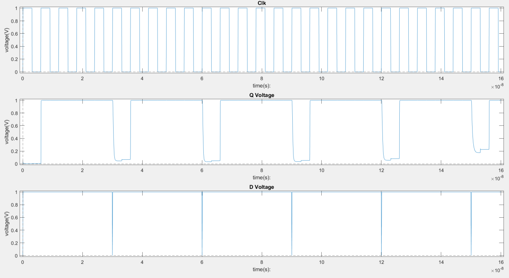

# D Flip-Flop Timing, Internal-Node Behavior, and Clock Overlap

Transistor-level HSPICE studies of sequential CMOS circuits: a baseline and modified 180 nm D flip-flop, followed by a 32 nm transmission-gate D flip-flop with delayed complementary-clock generation.

The work examines capture timing, internal-node and power waveforms, toggle operation, and sensitivity to clock overlap. In the report's 180 nm comparison, the modified circuit reduces average power from **12.3048 µW to 11.7862 µW**, about **4.21%**, while the reported clock-to-Q delay increases from **97.1651 ps to 761.7012 ps**. This is a measured tradeoff in the reported experiments, not an unconditional improvement.

**Reproducibility status:** the archive contains final toggle-mode and clock-overlap decks, not the complete set of timing and reset testbenches used in the report. Report-derived measurements and historical `.mt0` outputs are identified separately below. No fresh HSPICE execution was performed during repository preparation.

## Engineering questions

The 180 nm study investigates whether modifying the charging path of internal node B changes unwanted output pulses, average power, and capture timing. Both circuits are also operated with complementary-output feedback to demonstrate toggling.

The 32 nm study investigates how a transmission-gate storage circuit captures data and how delayed generation of the complementary clock affects its timing margin. These two technology studies are separate experiments; their delay values are not a controlled technology-scaling comparison.

## Implemented circuits

### 180 nm baseline and modified DFF

The report identifies rising-edge data capture and an active-low `rst` control. The baseline contains 12 MOSFETs. The modified version contains 13: the added PMOS P7 in the schematic corresponds to `M13` in the netlist and is controlled by node A. It is inserted in series with the clock-controlled charging path to B. The original clocked PMOS `M3` is also widened from 440 nm to 880 nm; the added device is 880 nm wide. Consequently, the comparison includes a topology change and resizing, not only one extra transistor.

The archived decks connect `Qb` to the input-device gates and hold `rst` at VDD. They are **toggle-mode configurations**, with no independent D source and no reset pulse. Timing and reset results in the report require other stimulus configurations that were not preserved as separate runnable decks.

The `rst` label should not be assumed to mean an asynchronous clear of Q. It pulls B high when asserted low; with the downstream clocked path conducting, this can drive Qb low and Q high. Output polarity and clock dependence must be specified before describing it as a reset or preset interface.

### 32 nm transmission-gate DFF

The circuit uses two transmission gates and two signal-path inverters. The first gate transfers data during the low-clock phase and the second during the high-clock phase, producing rising-edge capture under nominal complementary clocks. Storage relies on internal-node capacitance; there are no explicit feedback keepers in the supplied topology.

The archived overlap deck generates `clkb` through **nine cascaded inverters**, `X5` through `X13`, rather than the single inverter used for the nominal conceptual circuit. It contains 26 MOSFETs in total: 4 in the transmission gates, 4 in the signal-path inverters, and 18 in the clock chain. Its waveform illustrates a delayed-clock experiment, not the nominal timing testbench.

## Simulation conditions

| Parameter                              | 180 nm study                                    | 32 nm TG study                  |
| -------------------------------------- | ----------------------------------------------- | ------------------------------- |
| Supply                                 | 1.8 V                                           | 1.0 V                           |
| Channel length                         | 180 nm                                          | 32 nm                           |
| Basic NMOS / PMOS widths               | 220 / 440 nm, with branch-dependent multipliers | 96 / 192 nm                     |
| Input rise/fall duration               | 50 ps                                           | 80 ps                           |
| Archived clock period                  | 10 ns, 100 MHz                                  | 6 ns, about 166.7 MHz           |
| Nominal clock high duration            | 5 ns                                            | 3 ns                            |
| Transient duration                     | 800 ns                                          | 160 ns                          |
| Transient output interval              | 1 ps                                            | 1 ps                            |
| Explicit capacitors                    | None                                            | 10 fF at N1 and N2              |
| Model file                             | `mm018.l`, `tt`, `nch` / `pch`                  | `32nm_bulk.pm`, `nmos` / `pmos` |
| Temperature in historical `.mt0` files | 25 °C                                           | 25 °C                           |

The source decks do not explicitly set temperature. The 180 nm clock is 100 MHz, not a GHz-range characterization. Only two 10 fF capacitors are present in the TG deck; the additional I3-output capacitor specified in the design brief is absent.

## Reported 180 nm behavior



_Figure 1. Baseline clock, reset, output, and data waveforms in the report's comparison experiment. This externally driven reset/data experiment is not the archived toggle deck._



_Figure 2. Modified-circuit waveforms._



_Figure 3. Reported comparison of clock, reset, node-B voltage, and instantaneous power._

### Timing and power

| Metric                    |   Baseline |    Modified |
| ------------------------- | ---------: | ----------: |
| Setup-time estimate       |      90 ps |      113 ps |
| Hold-time estimate        |      19 ps |      980 ps |
| Selected clock-to-Q delay | 97.1651 ps | 761.7012 ps |
| Average power, 0–800 ns   | 12.3048 µW |  11.7862 µW |

The reported power reduction is approximately 0.5186 µW, or 4.21%. The selected clock-to-Q delay increases by about 7.84 times, and both setup and hold estimates increase. The evidence supports a tradeoff between the displayed waveform behavior, power, and timing. It does not support describing the modified circuit as faster or better in every respect.

Setup and hold values were chosen by visually inspecting simulations while adjusting stimulus parameters. A formal pass/fail criterion, clock-to-Q degradation limit, and complete boundary-sweep data were not supplied. These values are therefore reported experimental estimates, not signoff timing constraints.

The modified toggle deck declares `thold=900p`. In the archived toggle decks, `tsetup` and `thold` do not control any source or measurement, so these parameter declarations do not reproduce or validate the timing estimates.

### Toggle operation



_Figure 4. Reported toggle-mode output comparison with Qb fed back to the data-input devices. This is the operating mode represented by the two archived 180 nm decks._

Toggle operation nominally divides the clock frequency by two when each active clock edge causes a valid state change. The supplied experiments do not establish a maximum toggle frequency or startup robustness across initial conditions.

## Transmission-gate timing and clock overlap



_Figure 5. Nominal TG timing experiment. It illustrates the setup-time investigation; the nominal single-inverter timing deck is not included in the archive._

| Nominal TG metric         | Reported value |
| ------------------------- | -------------: |
| Setup-time estimate       |         139 ps |
| Hold-time estimate        |           0 ps |
| Selected clock-to-Q delay |     95.9566 ps |
| Q rise time, 10–90%       |     49.4355 ps |
| Q fall time, 90–10%       |     74.3161 ps |

The historical `Part2/TGDDF.mt0` instead contains `tfall = 72.78 ps`. This discrepancy is retained rather than resolved by mixing sources. The final TG deck has no `.measure` statements and uses a nine-inverter clock chain, so running it will not regenerate the nominal table or explain the fall-time difference.

The reported zero hold estimate applies only to the tested nominal configuration and criterion. It is not a general guarantee of zero hold time under clock skew, process variation, or a different load.



_Figure 6. Reported clock, Q, and D waveforms after increasing complementary-clock delay. The output no longer preserves the nominal timing behavior._

With delayed clock inversion, CLK and CLKB can temporarily have equal logic values. These intervals alter transmission-gate conduction and can expose data movement through both stages. The report associates the resulting output disturbance with a need to reassess hold time. However, the final deck prints only D, Q, and CLK, not CLKB. Separate low-low and high-high overlap durations, and a revised numerical hold constraint, were not established in the supplied evidence.

## What can be reproduced from the archive?

| Experiment                               | Available source                                    | Status                                                                  |
| ---------------------------------------- | --------------------------------------------------- | ----------------------------------------------------------------------- |
| Baseline and modified 180 nm toggle      | Two complete electrical topologies with Qb feedback | Archived source and concluded-run listings available                    |
| 180 nm setup / hold / clock-to-Q         | snippets and screenshots                            | Separate testbenches and automated sweeps absent                        |
| Reset-driven node-B and power comparison | plots; older power `.mt0` files                     | Archived final decks hold reset inactive and do not print B or power    |
| Nominal TG setup / hold / output slopes  | figures; older single-metric `.mt0`                 | Nominal experiment deck absent                                          |
| TG delayed-clock experiment              | Final nine-inverter deck and listing                | Available, with simulator warnings and source/output consistency limits |

The listings and `.mt0` files belong to different saved stages of the work. All three final decks lack measurement directives, while the older `.mt0` files contain power or fall-time results. Preserve that distinction when using the repository as evidence.

## Repository structure

| Path                                 | Purpose                                          |
| ------------------------------------ | ------------------------------------------------ |
| `netlists/dff180_baseline_toggle.sp` | Baseline 180 nm toggle experiment                |
| `netlists/dff180_modified_toggle.sp` | Modified 180 nm toggle experiment                |
| `netlists/tgdff32_clock_overlap.sp`  | TG circuit with delayed complementary clock      |
| `results/reported-results.csv`       | Values with source and evidence-status columns   |
| `results/reference/`                 | Unmodified historical `.mt0` files               |
| `results/listings/`                  | Losslessly compressed original `.lis` files      |
| `docs/figures/`                      | images used above                                |
| `docs/evidence/`                     | images including measurement screenshots         |
| `docs/original-netlists/`            | Exact source files before packaging              |
| `scripts/run.sh`                     | Local HSPICE runner                              |
| `runs/`                              | Generated outputs, excluded from version control |

## Run the archived final configurations

Install HSPICE and place the original compatible `mm018.l` and `32nm_bulk.pm` files in `models/`. Models are not bundled.

From the repository root:

```bash
bash scripts/run.sh
```

For one experiment:

```bash
mkdir -p runs
cd netlists
hspice -i dff180_baseline_toggle.sp -o ../runs/dff180_baseline_toggle
```

The relative includes require the `netlists/` working directory. Packaged decks differ from the exact archived sources only in title, model path, and an added explicit `.end` terminator. Electrical topology, stimuli, and parameter values were preserved. Since the final decks have no `.measure` commands, inspect their printed waveforms; new summary measurements will require a documented testbench revision.

The archived TG listing reports an adjusted data-pulse period, an ACDE model warning, and singular supplies terminated with a 1 MΩ resistor. The final source was saved after that listing, so the listed pulse adjustment must not be assumed to describe the current source exactly. Review warnings in any new run.
